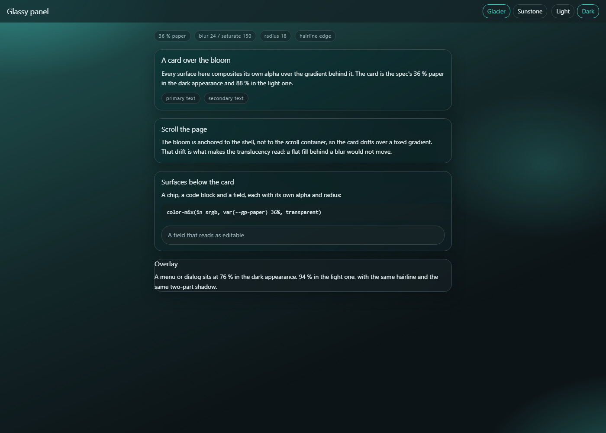

# glassy-panel-design

**A design spec for translucent "glassmorphic" UI that still passes contrast
checks, plus the Node validator that proves it.** Every number in here came off
rendered pixels or out of the script in `tools/` — none of it was picked by eye.

What you get: a CIE L\* (perceptual lightness) ladder for 14 semantic colour
roles, a 16-pair contrast contract (text ≥ 4.5:1, boundaries ≥ 3:1), a material
table of surface alphas, blurs, radii and shadows, type and spacing metrics, and
two complete reference palettes — Glacier (cool teal) and Sunstone (warm
terracotta) — each with a light and a dark appearance. The shot above is the
worked example in `examples/`, in Glacier on the dark appearance.



## State

Finished and stable. I built it for a side panel, then pulled the portable parts
out; I apply it by hand and it is not published as a package. One owner item is
still open — a provenance decision — listed in `docs/owner-todos.md`.

## Quick check

    node tools/theme-contrast-check.mjs palettes/glacier.json
    node tools/theme-contrast-check.mjs palettes/sunstone.json
    # exit 0 = every pair clears its minimum; 1 = at least one failure

The tightest pair in either palette is Sunstone light `line on canvas` at
3.37:1 against a 3.0 minimum. That is the one to re-check first if you re-hue it.

## What is in here

| File | What it is |
| --- | --- |
| `docs/spec.md` | The full spec: ladder, contrast contract, material table, type and rhythm, pitfalls. |
| `docs/provenance.md` | Where the numbers came from and how they were measured. |
| `docs/validator-output.md` | The verbatim validator run on both palettes. |
| `tools/theme-contrast-check.mjs` | The validator. Standalone: no dependencies, no imports. |
| `palettes/glacier.json` | Reference palette, cool (teal + cool slate), darker. |
| `palettes/sunstone.json` | Reference palette, warm (terracotta + warm graphite). |
| `examples/` | Worked example: `glass.css` plus a single-file `index.html` demo. |

## The numbers

These are validator output and pixel measurements, not estimates. The tables
below are the committed palettes at the committed script version; re-run the
validator after any hex change.

### The lightness ladder

Themes are designed as a CIE L\* ladder (perceptual lightness, 0 = black,
100 = white), not as hex guesses. To build a new palette, pick one hue and place
these values.

| Role | Light appearance | Dark appearance |
| --- | --- | --- |
| `primaryDeep` (shell) | L\* 91.0–91.4 (just under canvas) | L\* 3.1–4.8 (just under canvas) |
| `canvas` | L\* 91.6–95.3 | L\* 5.9–8.1 |
| `paper` | L\* 99.2–99.4 (Δ to canvas +3.9 to +7.8) | L\* 11.5–12.7 (Δ to canvas +4.6 to +5.6) |
| `input` | = paper | L\* 14.4–15.9 (Δ to paper +2.9) |
| `ink` | L\* 12.9–13.6 | L\* 94.6–94.8 |
| `muted` | L\* 36.6–38.3 | L\* 70.1–71.7 |
| `line` | L\* 52.1–52.7 | L\* 49.8–49.9 |
| `accent` | L\* 40.4–41.8, saturation 74–90 % | L\* 72.0–73.8, saturation 54–79 % |

### Measured contrast

Every value is validator output. Both palettes pass all 16 contract pairs in
both appearances. The 12 pairs below are the ones the spec documents; the other
four (`onPrimary on primary`, `onDanger on danger`, `danger on paper`,
`primary on paper`) are enforced by the validator and printed in full in
`docs/validator-output.md`.

| Pair | Sunstone L / D | Glacier L / D | Minimum |
| --- | --- | --- | --- |
| ink on canvas | 12.74 / 15.61 | 14.25 / 16.22 | 4.5 |
| ink on paper | 15.53 / 14.13 | 15.74 / 14.47 | 4.5 |
| ink on input | 15.53 / 13.02 | 15.74 / 13.48 | 4.5 |
| muted on canvas | 5.57 / 7.77 | 6.50 / 8.53 | 4.5 |
| muted on paper | 6.79 / 7.03 | 7.17 / 7.61 | 4.5 |
| accent on canvas | 4.88 / 8.26 | 5.66 / 9.09 | 4.5 |
| accent on paper | 5.95 / 7.47 | 6.24 / 8.11 | 4.5 |
| onAccent on accent | 6.04 / 8.22 | 6.37 / 8.85 | 4.5 |
| danger on canvas | 5.29 / 6.98 | 5.80 / 6.70 | 4.5 |
| shellForeground on primaryDeep | 12.52 / 16.64 | 12.91 / 17.15 | 4.5 |
| line on canvas | 3.37 / 3.94 | 3.61 / 4.12 | 3.0 (boundaries) |
| line on paper | 4.10 / 3.56 | 3.99 / 3.68 | 3.0 (boundaries) |

Worst boundary case: **Sunstone light `line on canvas` at 3.37:1** against its
3.0 floor. Worst text case: **Sunstone light `accent on canvas` at 4.88:1**
against 4.5.

### Surface alpha

Surface alpha is the dial that decides whether the glass reads. It has a
threshold, not a taste. Measured on a text-free column inside a card, over the
bloom:

| Variant | Card surface, top → bottom | Ink on lightest composite |
| --- | --- | --- |
| 46 % paper, weaker bloom | `#0d2123` → `#0c1519` | 14.6:1 |
| 36 % paper, stronger bloom | `#0d2527` → `#193437` → `#0b1417` | 14.0:1 |

At 46 % the ramp is ~1.6 luminance steps — real but invisible. At 36 % it is
~2.3 steps with a visible hue shift, and text still holds 14:1. On a light canvas
the opposite holds: cards go to 88 %, or the bloom reads as a stain on the white.

## Why glass reads as glass

Three rules carry the look. Break one and it stops reading as glass.

1. **Put a gradient behind the blur.** A blur over a flat fill is a flat fill.
   Build the bloom — three radial gradients from the accent colour — and anchor
   it to the shell, not to the scroll container.
2. **Surface alpha is a threshold, not a taste.** 46 % on a dark canvas is
   invisible; 36 % reads. 78 % on a light canvas stains the white; 88 % stays
   crisp. The threshold depends on the appearance.
3. **Separate surfaces with a hairline and depth, not with value.** Paper sits
   only 4–8 L\* above the canvas, so the border (`1px color-mix(in srgb, paper
   50%, line)`) and the two-part shadow do the separating.

## The material table

Values from spec §3. The table is appearance-aware, not hue-aware: it does not
change when you re-hue.

| Element | Fill | Blur | Radius | Edge |
| --- | --- | --- | --- | --- |
| Cards (messages, panels) | paper 36 % | `blur(24px) saturate(150%)` | 18 px | `1px color-mix(paper 50%, line)` |
| Chips, pills, table wrap, code | paper 45 % | `blur(12px) saturate(120%)` | 14 px | `1px color-mix(paper 55%, line)` |
| Code block | paper 40 % | — | 12 px | — |
| Composer / search field | paper 44 % | `blur(20px) saturate(130%)` | 20 px | same as chips |
| Bars (header, dock) | panel 72 % | `blur(22px) saturate(130%)` | — | none |
| Overlays (menus, dialogs) | menu 76 % | `blur(24px) saturate(130%)` | 18 px | `1px color-mix(paper 55%, line)` |
| User's own turn | accent 20 % over paper 44 % | inherits card | 18 px | `1px accent 42 %` |

The table above is the dark-appearance recipe. In a light appearance the surface
alphas move up: **88 % is the floor** for cards, and the band across surfaces is
88–94 % (composer 88 %, cards 88–92 %, chrome 94 %). A light translucent card
separates by its hairline, so it also needs a harder edge (`line 70 %`) and a
deeper shadow (`0 10px 30px line 22 %`).

Two ingredients on every floating card — a top-edge highlight and depth, not a
drop shadow:

```css
box-shadow:
  inset 0 1px 0 color-mix(in srgb, var(--gp-paper) 80%, transparent),
  0 10px 30px color-mix(in srgb, var(--gp-shell) 34%, transparent);
```

One accent ring on focus, never a second outline:

```css
:focus-visible {
  border-color: var(--gp-accent);
  box-shadow: 0 0 0 3px color-mix(in srgb, var(--gp-accent) 26%, transparent);
}
```

## Worked example

`examples/` is a portable build of the material table with no app tokens in it.
Open `examples/index.html` in a browser — no build step, no dependencies — and
switch palette and appearance with the two toggles. `examples/glass.css` is the
material layer on its own; copy it and define the eight `--gp-*` colours for your
theme. `examples/README.md` walks the five steps and notes one scaling caveat.

The shot at the top of this page is that example's default state — Glacier, dark.
The page also carries Sunstone and a light appearance for both palettes; use the
two toggles in the header rather than trusting a screenshot of the other three
states, which I could not capture honestly (the bloom does not survive a
headless light-appearance capture, so there is no light shot here).

## The validator

`tools/theme-contrast-check.mjs` is standalone: no dependencies, no imports, no
knowledge of any app. Read it, copy it, run it anywhere Node runs.

### Usage

    node tools/theme-contrast-check.mjs <theme.json>

- exit 0 — every pair clears its minimum.
- exit 1 — at least one schema or contrast failure.
- exit 2 — no path argument.

### Expected output

A run on `palettes/glacier.json`, trimmed to the light contrast block, the top of
the ladder and the result line (the full run for both palettes is in
`docs/validator-output.md`):

```text
$ node tools/theme-contrast-check.mjs palettes/glacier.json

=== contrast · light (colors) ===
ok   ink on canvas                14.25:1  (min 4.5)
ok   ink on paper                 15.74:1  (min 4.5)
ok   ink on input                 15.74:1  (min 4.5)
ok   muted on canvas               6.50:1  (min 4.5)
ok   muted on paper                7.17:1  (min 4.5)
ok   onPrimary on primary          6.37:1  (min 4.5)
ok   onAccent on accent            6.37:1  (min 4.5)
ok   onDanger on danger            6.54:1  (min 4.5)
ok   shellForeground on primaryDeep   12.91:1  (min 4.5)
ok   line on canvas                3.61:1  (min 3)
ok   line on paper                 3.99:1  (min 3)
ok   danger on canvas              5.80:1  (min 4.5)
ok   danger on paper               6.41:1  (min 4.5)
ok   accent on canvas              5.66:1  (min 4.5)
ok   accent on paper               6.24:1  (min 4.5)
ok   primary on paper              6.24:1  (min 4.5)

=== lightness ladder · light (colors) ===
  role            hex        L*     h    s%    l%
  canvas          #eef2f4   95.3  200    21    95
  paper           #fbfdfe   99.2  200    60    99
  ...
  -> surface step (paper - canvas) = 3.9 L*  (design range: 4-8)

=== schema ===
  ok   all required roles present, exact lowercase #rrggbb, schemaVersion 1

RESULT: PASS — every contract pair within minimum
```

### What it checks

- All 14 roles are present in each appearance.
- Every colour is exact lowercase `#rrggbb`.
- `schemaVersion` is 1.
- No unknown roles and no unknown top-level keys.
- 16 contrast pairs per appearance against the contract above.
- The CIE L\* / HSL ladder, plus the paper−canvas surface step (design range
  4–8 L\*).

### What it does not check

The validator computes WCAG 2.1 contrast on **opaque hex** pairs only. Every
surface in the material table is translucent, so a `PASS` proves the palette is
sane before compositing — it does **not** prove the composited card passes. The
script also does not implement APCA (the Accessible Perceptual Contrast
Algorithm), and it does not apply the WCAG AA large-text exemption, which is
size-aware. To test the glass itself, sample rendered pixels: take a text-free
column inside a card and compare the top against the bottom. A flat result means
the surface is an opaque fill, whatever the CSS says.

## Making your own palette

1. Pick one hue family (≤ 25° of spread) and an appearance to start from.
2. Place the ladder from `docs/spec.md` §2: canvas, paper (+4–8 L\*), input, ink,
   muted (~L\* 37 light / 71 dark), line (~L\* 50), accent (L\* 40 light / 73
   dark, high saturation), primaryDeep just past the canvas.
3. Run the validator. Text pairs must clear 4.5:1 and boundaries 3:1. If the
   accent fails against the canvas, darken the accent; if the canvas is too light
   for the cards to separate, deepen the canvas *and* darken the accent together.
4. Apply the material table from §3 unchanged.
5. Verify on rendered pixels, not in the editor.

## Type and rhythm

| Role | Size | Leading | Tracking |
| --- | --- | --- | --- |
| Body / reply text | 14 px (clamp 12–28 px) | 1.6 | 0 |
| Headings h1–h5 | 21 / 18.5 / 16.5 / 15 / 14 px | 1.18 | −0.01em |
| Micro tier (labels, chips, status) | floor 11 px | 1.45 | +0.07em |
| Code block | 12.5 px | 1.55 | — |
| Table cells | 13 px | 1.45 | — |

Three rules the numbers produce:

- **11 px is a hard floor** for anything a reader must read. The micro tier
  routes through one variable, so a text-size change moves it everywhere.
- **Secondary text needs a calibrated tone, not the theme's mid grey**: `ink` at
  0.88 alpha clears 6.9:1 dark, 0.82 clears 4.7:1 light. Boundaries take 0.6.
- **Nesting goes outside-in**: 18 px cards holding 14 px chips holding 12 px
  code never look like one blob.

## Provenance

The numbers came off rendered pixels. The method was a headless browser capture
(Chrome DevTools Protocol) of a Chromium side panel at 320 px and 420 px, then
pixel sampling with Pillow. The measurements were taken in a private project, so
you cannot repeat the run; `docs/provenance.md` records the method so you can
repeat the *method*, and lists the hard numbers that are safe to quote.

## Pitfalls

Six pitfalls from spec §8, each of which cost a real iteration.

- **Blur without a gradient behind it is invisible.** Build the bloom first.
- **46 % surface alpha is too subtle to read as glass** on a dark canvas; on a
  light one the floor is 88 %, or the bloom reads as a stain.
- **A parallel design system will ignore your tokens somewhere.** Two controls
  were painted a hard-coded brand blue regardless of theme; sweep for hard-coded
  colours before you call a theme fully themed.
- **A `:` in a generated Windows filename** silently creates an NTFS alternate
  data stream and the file vanishes. Sanitise `[:\/*?"<>|]`.
- **A text-size setting that skips tiers** produced 8 px labels that never grew.
  Route every tier through the setting.
- **A light translucent card needs its own edge treatment** — reusing the dark
  recipe gives cards that merge with the canvas. The hairline is load-bearing.

## Licence

MIT. See [`LICENSE`](LICENSE).

## Credits

- No third-party code is copied into this repo. The spec text, the validator and
  both palettes are mine.
- The contrast and lightness maths implement public standards: WCAG 2.1 relative
  luminance (W3C) and the CIE L\* formula (CIE). The script re-implements them
  from the published definitions; no third-party code was vendored.
- The original measurements used Pillow (pixel sampling) and the Chrome DevTools
  Protocol (headless capture), both named for method only. No code from either
  was copied.
